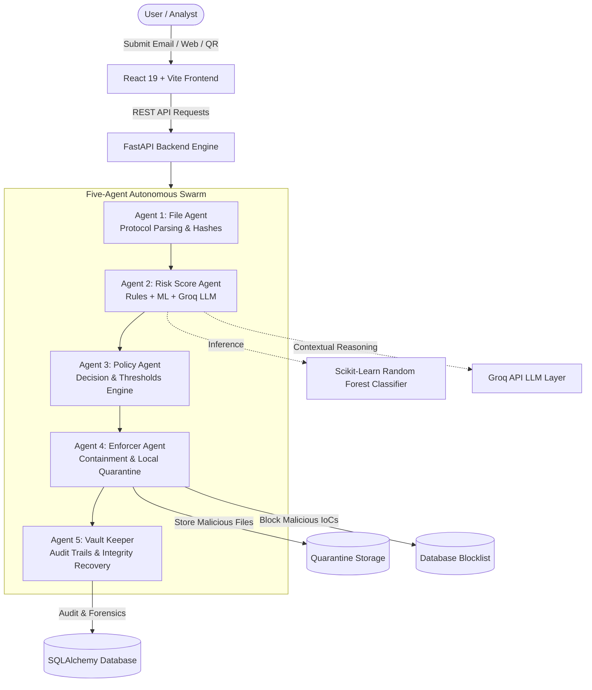

# PhishSenital Platform Architecture

**PhishSenital** is designed as a modular, distributed cybersecurity SaaS platform combining deterministic protocol analysis, machine learning inference, and large language model (LLM) contextual reasoning.

---

## The Five Specialized Agents

### 1. File Agent (`file_agent.py`)
- **Responsibility**: Ingestion, syntax extraction, format normalization, and cryptographic hashing.
- **Protocols Supported**:
  - Raw MIME & `.eml` emails: Extracts headers, From/Reply-To, Message-ID, SPF/DMARC auth status, body text, and attachments.
  - Web URLs: Normalizes URL structure, extracts hostname, path, userinfo, query parameters.
  - QR Code Matrices: Decodes bitmap via OpenCV `QRCodeDetector`, parses UPI/Crypto/WiFi schemas.
- **Security Safeguards**: Never executes attachments or follows hyperlinks.

### 2. Risk Score Agent (`risk_score_agent.py`)
- **Responsibility**: Tri-layer threat assessment and calibrated fraud probability scoring.
- **Detection Architecture**:
  1. **Deterministic Rule Engine**: Domain mismatch, typosquatting (Levenshtein distance & homoglyphs), high-risk TLDs, urgent social engineering, double extensions.
  2. **Machine Learning Model**: 15-feature numeric extraction evaluated by a trained `RandomForestClassifier`.
  3. **Groq Contextual Intelligence**: Structured JSON generation for SOC-level threat explanation and defensive actions.
- **Output**: Calibrated risk score (0-100), risk level (SAFE, MODERATE, HIGH, CRITICAL), confidence, and explainable indicators.

### 3. Policy Agent (`policy_agent.py`)
- **Responsibility**: Intelligent security decision-making based on configurable threshold bands.
- **Decision Matrix**:
  - `0 - 19` (Low / Safe): `ALLOW` — Standard processing permitted.
  - `20 - 39` (Moderate): `CAUTION` — Caution advisory and verification recommended.
  - `40 - 69` (High): `WARN_REVIEW` — Strong warning; flagged for SOC review.
  - `70 - 100` (Critical): `BLOCK_QUARANTINE` — Immediate automated containment.
- **Safety Policy**: LLM output cannot override binding deterministic safety thresholds.

### 4. Enforcer Agent (`enforcer_agent.py`)
- **Responsibility**: Safe, application-managed containment.
- **Capabilities**:
  - Quarantines malicious attachments into isolated local storage (`storage/quarantine/`).
  - Adds verified malicious URLs/domains to internal database blocklist.
  - Wraps dangerous hyperlinks with safety interceptors.
  - Non-invasive: Never alters Windows firewall, host registry, or external network settings.

### 5. Vault Keeper (`vault_keeper.py`)
- **Responsibility**: Recovery, forensics, and cryptographically verified restoration.
- **Capabilities**:
  - Computes baseline SHA-256 hashes and logs incident history.
  - Performs real-time hash verification on disk before authorized file restoration.
  - Formulates post-incident containment and recovery plans.
